# 拾味日常 · 用户指南（注册登录后怎么用）

本文面向**普通用户**：从注册登录开始，说明日常怎么用、数据怎么流转、功能如何闭环。更细的逐步核验与后台操作见 [操作手册](user-manual/README.md)；研发/运维口径见 [数据闭环说明](user-manual/closed-loop.md)。

> 营养估算与 AI 输出仅供日常参考，不能替代医疗建议。截图为本地演示环境（虚构账号），请勿照搬其中的数值到真实账号。

---

## 1. 先弄清产品在帮你做什么

拾味日常的主线是：**今天吃了什么 → 对照目标还差多少 → 下一顿吃什么**。  
库存、采购、做饭是支撑这条主线的厨房能力，不是替代主线。

```text
注册 / 登录
   │
   ▼
健康档案（热量 · 蛋白 · 碳水 · 脂肪 · 过敏忌口）
   │
   ├──────────────► 饮食记录（手动 / 识图 / 做饭后记入）
   │                        │
   │                        ▼
   │               今日汇总（首页宏量环）
   │                        │
   │                        ▼
   └──────────────► 下一餐教练 / 推荐 / 助手
                              │
                              ▼
                    营养分析（近 7 / 30 日趋势）

可选厨房支撑：入库 → 采购 → 烹饪队列 → 做饭扣减 → 再写回饮食记录
```

**最短上手（约 5 分钟）**

1. 注册并登录  
2. 健康档案设目标热量（建议同时补蛋白/碳水/脂肪与过敏）  
3. 记一餐  
4. 回首页看热量环与剩余  
5. 点「下一餐教练」或推荐安排下一顿  
6. 在「我的 → 营养分析」看近 7 日趋势  

---

## 2. 注册与登录

### 2.1 创建账号

打开客户端 → **创建账号**：填写公开用户名、邮箱、密码并同意协议。

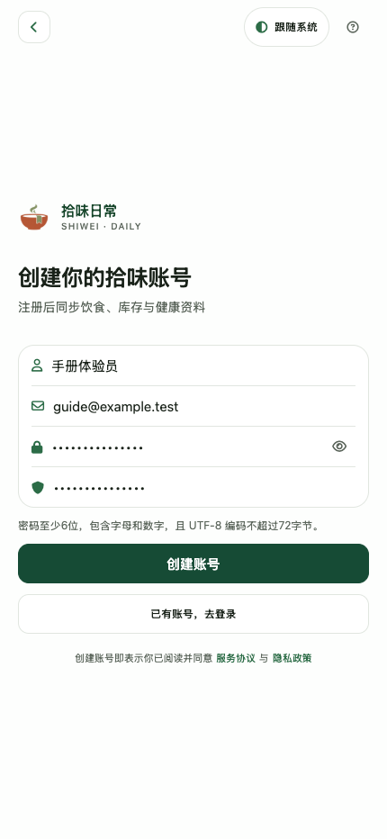

### 2.2 登录

使用**邮箱 + 密码**登录。共享设备不要勾选长期记住。

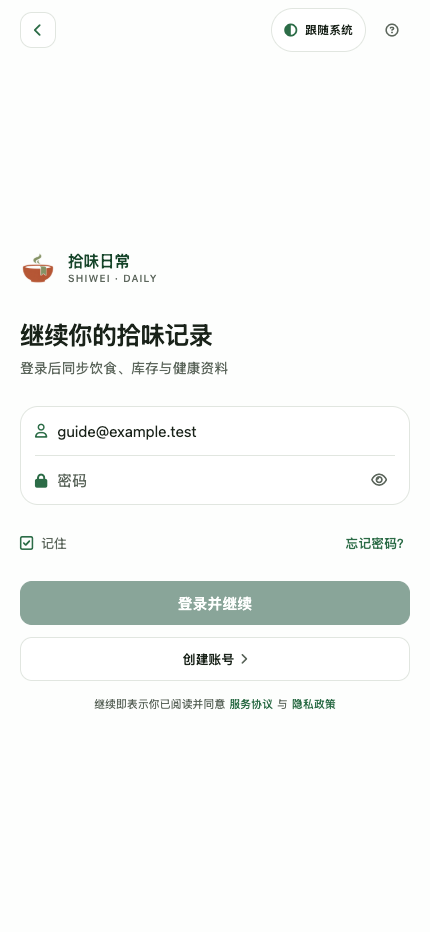

### 2.3 新手引导（可稍后）

首次进入可完成：管理食材 / 安排一餐 / **记录一餐** / **设置营养目标**。也可跳过，之后在「我的」补全。

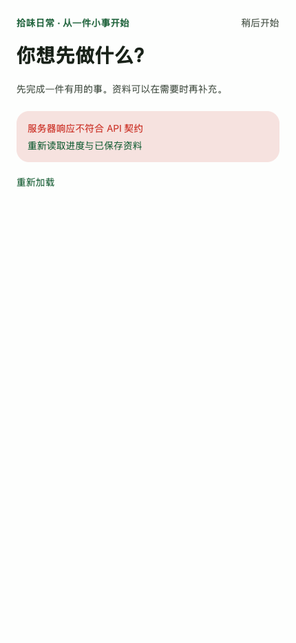

---

## 3. 四个底部入口

| Tab | 做什么 | 在闭环里的角色 |
| --- | --- | --- |
| **首页** | 今日营养环、下一餐教练、推荐、助手、临期提醒 | 结果面 + 下一餐入口 |
| **资产** | 食材库存、厨具、入库 | 厨房能力输入 |
| **社区** | 动态、关注、发帖 | 不计入营养合计 |
| **我的** | 健康目标、营养分析、餐单/烹饪、设置 | 目标与回顾 |

右上角搜索可查菜谱 / 食材 / 社区 / 用户。

---

## 4. 设目标：健康档案

**入口**：我的 → 健康相关入口 → 营养目标 / 饮食限制。

建议先填：

- 每日热量、蛋白质、碳水、脂肪  
- 过敏与忌口（影响推荐过滤与降权）  

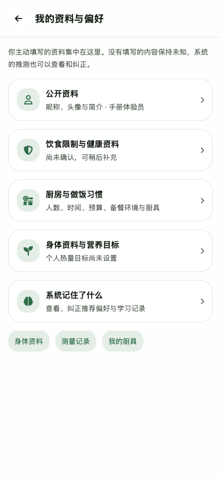

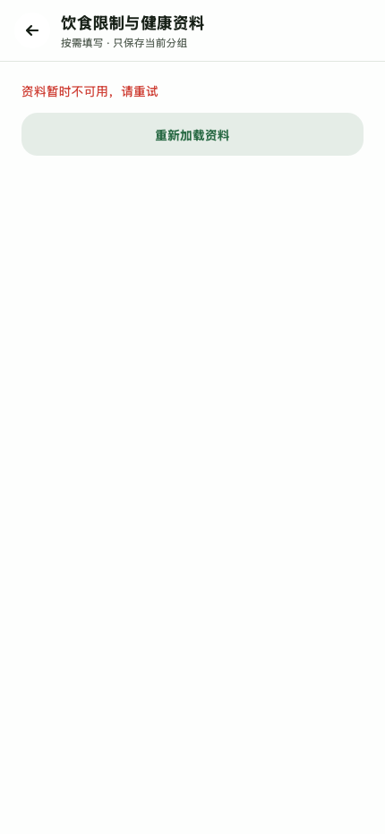

这些目标会进入：

1. 首页今日环与剩余额度  
2. 营养分析的达成率  
3. 推荐打分（按「目标 − 今日已摄入」排序）  

---

## 5. 记一餐：饮食记录

**入口**：首页热量区「记一餐」/ 我的 → 饮食记录。

1. 选择日期与餐别  
2. 填写食物名称、份量  
3. 有依据再填热量与宏量；没有就留空（显示「营养待补全」，**不要编造**）  
4. 可拍照识图预填，核对后再保存  

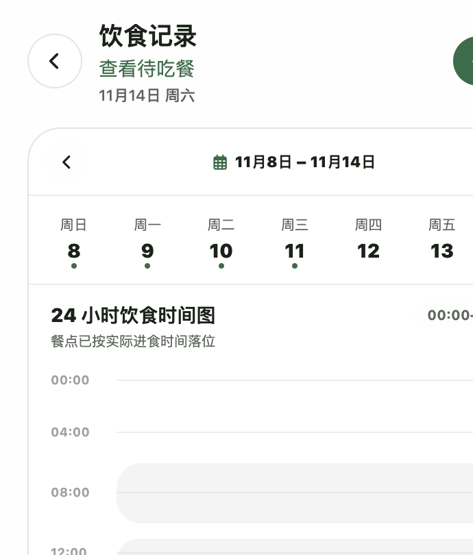

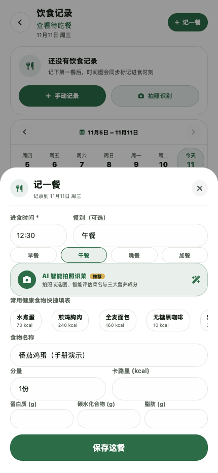

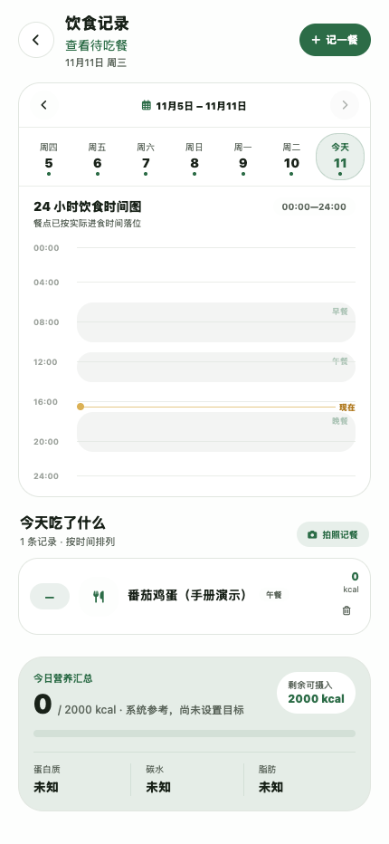

保存「今天」的一餐后，常会提示按剩余额度排序的下一餐候选，并可打开助手继续安排。

**数据去哪了**：写入服务端饮食记录（按 **Asia/Shanghai** 应用日汇总），首页与营养分析会立刻（或刷新后）看到变化。

---

## 6. 看结果：首页营养环与下一餐

登录后首页会展示今日已记摄入与目标对比，并给出下一餐入口。

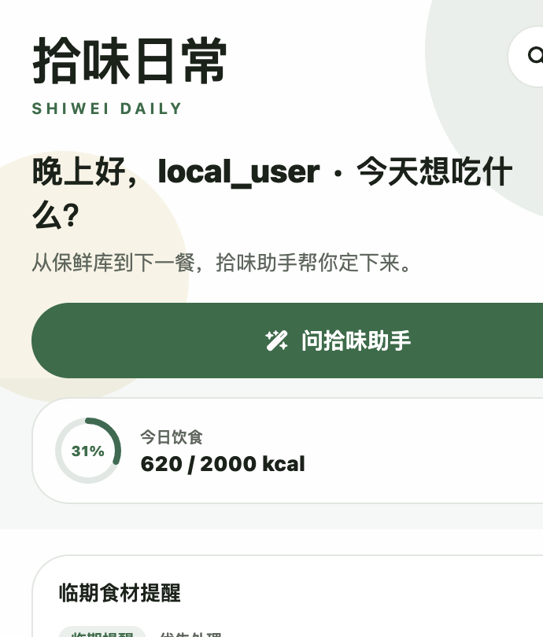

你可以：

- 点热量/宏量区进入饮食记录或营养分析  
- 滑动推荐卡：下一餐教练、时段推荐、临期提醒等  
- 点「问拾味助手」做自然语言搭配  

**调用关系（简化）**

| 你的操作 | 前端 | 后端 |
| --- | --- | --- |
| 打开首页 | 拉取今日饮食 + 健康目标 | `GET /diet-records?date=`、健康档案 |
| 保存一餐 | 写入记录并刷新 | `POST /diet-records` |
| 看 7/30 日趋势 | 营养分析页 | `GET /diet-records/summary?days=7\|30` |
| 下一餐/推荐 | 推荐卡 / 助手 | `POST /recommendations/recipes`（按目标−摄入、库存、过敏忌口打分） |

---

## 7. 回顾：营养分析（7 / 30 日）

**入口**：我的 → **营养分析**（首页宏量区也可进入）。

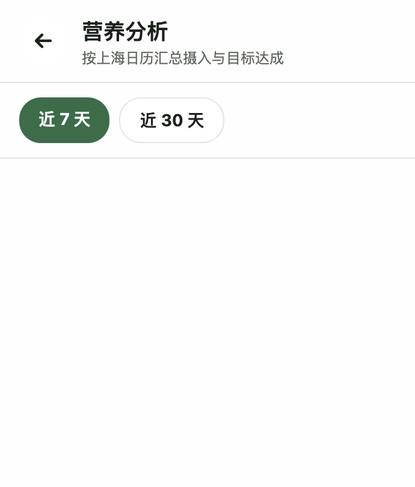

页面会展示：

- 近 7 / 30 天切换  
- 有记录天数、日均热量  
- 热量控制 / 蛋白充足达成率  
- 每日热量趋势柱  
- 今日剩余热量与宏量  

业务日统一按上海日历，避免跨时区把「今天」算错。登录后若接口短暂不可用，页面会提示「重试」。

---

## 8. 可选：厨房支撑闭环

当你希望「家里有什么 → 做什么 → 做完扣库存 → 再记摄入」时，走这条支撑链：

### 8.1 入库

资产 → 添加食材（手动 / 文字批量 / 识图；识别后必须核对）。

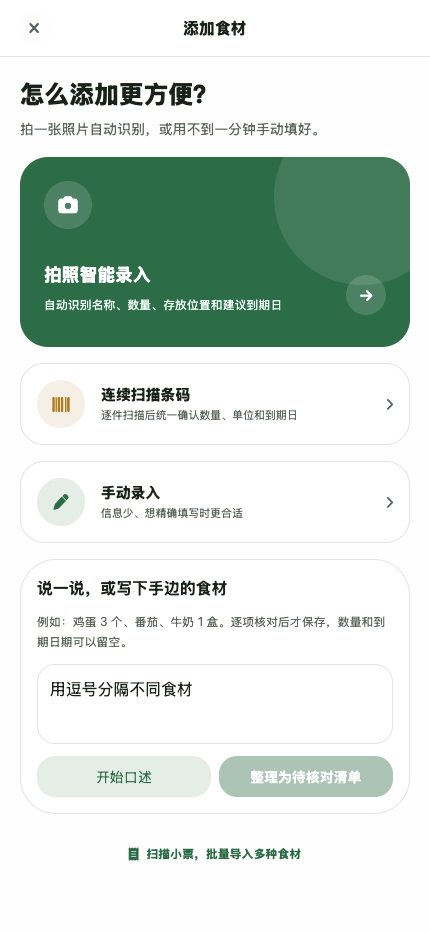

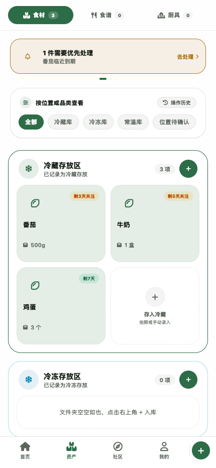

### 8.2 采购与做饭

- 采购清单补缺 → 买回再入库  
- 菜谱详情 → 加入烹饪队列 → 做饭模式 → 确认扣减与是否记摄入  

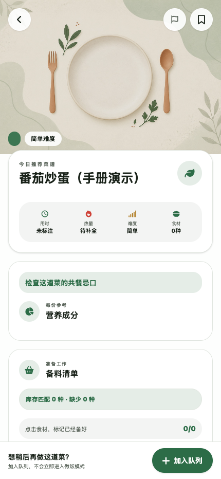

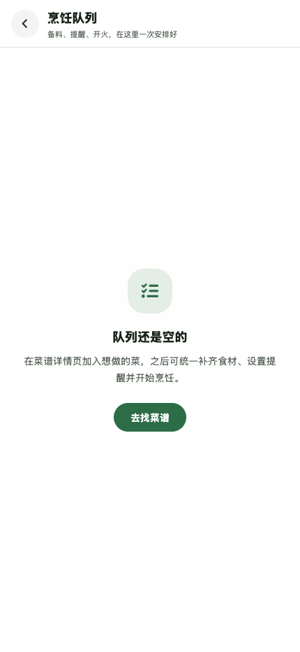

队列里的菜 ≠ 已经扣库存；只有在做饭完成并确认后才会扣减，并可选写入饮食记录，回流到首页营养环。

---

## 9. 我的：资料与服务入口

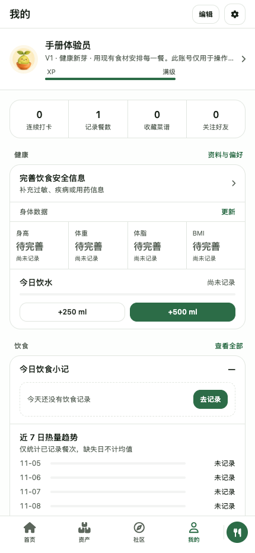

常用入口：

| 入口 | 用途 |
| --- | --- |
| 营养分析 | 7/30 日趋势与达成 |
| 健康档案 / 健康数据 | 目标、过敏、体重饮水等 |
| 餐单工作台 / 烹饪队列 | 计划与开做 |
| 共餐忌口 | 家庭共享限制 |
| 设置 | 主题、账号、做饭语音等 |

---

## 10. 数据怎么闭环（用户可读版）

```text
① 你在健康档案写下目标与忌口
        │
② 你通过记餐 / 识图 / 做饭完成，把「吃了什么」写进饮食记录
        │
③ 服务端按上海「今天」汇总热量与宏量
        │
④ 首页环、剩余额度、营养分析读这份汇总
        │
⑤ 推荐与下一餐教练用「目标 − 今日已摄入 + 库存可做 + 过敏忌口」排序
        │
⑥ 你按建议选菜做饭（可选扣库存），再产生新的饮食记录 → 回到 ③
```

两点重要约定：

- **日期**：客户端与服务端统一用 Asia/Shanghai 的 `YYYY-MM-DD` 作为应用日。  
- **缺营养字段**：留空比填假 0 更安全；分析页与环会区分「未知」与「已知」。

---

## 11. 场景速查

| 你想… | 建议路径 |
| --- | --- |
| 先体验营养主线 | 设目标 → 记一餐 → 首页看环 → 下一餐教练 |
| 看一周吃得稳不稳 | 我的 → 营养分析 → 近 7 / 30 天 |
| 家里有菜再决定吃什么 | 入库 → 首页/推荐 → 队列做饭 → 记摄入 |
| 菜快过期 | 首页临期卡 / 干预建议 |
| 做饭时少看屏幕 | 做饭模式开语音朗读 |
| 和家人一起 | 共餐忌口 |

---

## 12. 相关文档

| 文档 | 适合谁 |
| --- | --- |
| [操作手册](user-manual/README.md) | 逐步截图、后台管理、已知限制 |
| [数据闭环说明](user-manual/closed-loop.md) | 研发/验收：接口与边界 |
| [认证说明](authentication.md) | 注册登录与账号恢复策略 |
| [文档索引](README.md) | 全部现行文档入口 |
| [历史归档](archive/README.md) | 旧周报与验收流水（非日常必读） |
