# 拾味日常操作手册

**普通用户与后台运营管理员使用指南**

| 文档项目 | 内容 |
| --- | --- |
| 文档编号 | SWRC-UM-001 |
| 文档版本 | V1.0 |
| 编制与实操日期 | 2026-11-11 |
| 适用版本 | 当日 `refactor/ui-optimize` 工作区；包含用户管理、通知中心防崩溃修复，不代表正式发布版本 |
| 使用对象 | 普通用户、授权后台运营管理员 |
| 文档状态 | 基于实际页面编制的使用与培训参考；未完成的功能已单独标注 |
| 截图来源 | 实际 Expo Web 页面及后台 Web 页面；使用本地隔离数据库和虚构账号 |
| 配套记录 | [实操核验与截图索引](verification.md) |

> **阅读前须知**：本手册记录“页面实际能完成什么”，不把界面上的入口等同于已经接通的服务。当前版本尚未完成“采购—烹饪—库存扣减—饮食记录”的端到端核验。请先阅读下文的状态说明，再按对应步骤操作。

## 目录

1. [使用说明与准备](#1-使用说明与准备)
2. [账号注册与登录](#2-账号注册与登录)
3. [食材入库与库存维护](#3-食材入库与库存维护)
4. [采购、食谱与烹饪入口](#4-采购食谱与烹饪入口)
5. [饮食记录](#5-饮食记录)
6. [个人资料与健康资料](#6-个人资料与健康资料)
7. [设置、隐私与账号安全](#7-设置隐私与账号安全)
8. [社区动态](#8-社区动态)
9. [帮助与反馈](#9-帮助与反馈)
10. [后台管理员操作](#10-后台管理员操作)
11. [常见问题与处理](#11-常见问题与处理)
12. [当前限制与未验证范围](#12-当前限制与未验证范围)
13. [维护与修订](#13-维护与修订)

## 1. 使用说明与准备

### 1.1 本手册的范围

拾味日常用于管理家中食材、查阅食谱、记录实际饮食及交流饮食经验。普通用户使用客户端；授权管理员通过管理控制台处理用户、内容和服务配置。

本手册不是部署或数据库维护教程。服务安装、备份恢复、密钥管理和生产发布请另见 [部署与恢复手册](../operations.md)；账号策略见 [认证说明](../authentication.md)。

### 1.2 状态标记

| 标记 | 含义 | 使用方式 |
| --- | --- | --- |
| **已验证** | 已通过真实界面执行，并核对到可见结果；部分流程另做了重新进入或刷新核对 | 可依照步骤使用，但不代表所有设备与边界条件均已测试 |
| **部分可用** | 操作的一部分成功，但字段、汇总或后续环节存在限制 | 只使用已确认的部分；按说明核对结果 |
| **当前受限** | 实操遇到失败、接口不匹配或无法确认保存结果 | 不反复提交；记录现象并联系维护人员 |
| **未验证** | 仅查看入口，或需要真实设备、第三方服务、权限及额外数据 | 不将本手册作为功能验收证据 |

### 1.3 使用前准备

1. 取得维护人员提供的客户端和管理端访问地址。生产环境应使用 HTTPS。
2. 普通用户准备自己的注册邮箱；管理员必须使用单独授权的管理账号。
3. 在录入前核对实物名称、数量、包装日期与存储条件。不清楚的信息可以留空，不要为了填满表单而编造。
4. 涉及拍照、麦克风或通知时，须按设备提示授权；拒绝权限后可优先使用手动录入。
5. 健康资料只填写必要内容。反馈、社区动态和截图中不要出现密码、验证码、完整证件信息或无关健康资料。

**截图环境说明**：客户端采用 430 × 932 的浏览器视口，后台采用 1440 × 1000 的桌面视口。截图不是手机真机截图，键盘、权限弹窗和系统推送效果以实际设备为准。截图中的日期、数量、账号和记录均为演示数据，不应照搬到真实账号。

### 1.4 界面导航

| 区域 | 主要入口 | 用途 |
| --- | --- | --- |
| 客户端底部 | 首页 | 日常入口与推荐内容 |
| 客户端底部 | 资产 | 食材、食谱、厨具；食材页可新增与维护库存 |
| 客户端底部 | 社区 | 浏览内容与发布动态 |
| 客户端底部 | 我的 | 个人资料、饮食记录、设置等入口 |
| 后台左侧 | 工作台 | 查看待处理事项及运行概况 |
| 后台左侧 | 内容管理 | 食材库、食谱库、厨具库 |
| 后台左侧 | 用户与运营 | 用户成长、用户反馈、社区管理、通知中心 |
| 后台左侧 | 技术管理 | 展开后进入 AI 服务等配置区域 |

## 2. 账号注册与登录

### 2.1 创建普通用户账号

**状态：已验证。前提：能访问客户端，且邮箱未被注册。**

1. 在登录页点击 **创建账号**。
2. 填写 **用户名（公开显示）** 和 **邮箱**。
3. 输入密码并再次确认。当前页面要求：至少 6 位、包含字母和数字，UTF-8 编码不超过 72 字节。建议使用更长且不与其他网站共用的密码。
4. 阅读服务协议及隐私政策。
5. 点击 **创建账号**，等待页面给出结果，不连续重复点击。

**结果核对**：注册成功后可以使用同一账号登录。演示账号为“手册体验员”，邮箱为保留示例域名地址 `guide@example.test`，不是真实邮箱，也不是可供公众使用的演示账号。本手册不提供任何账号密码。

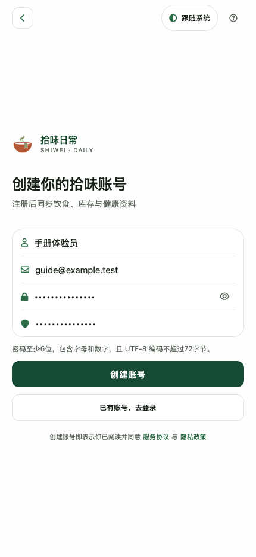

*图 2-1　普通用户注册。公开用户名与登录邮箱承担不同用途。*

### 2.2 登录已有账号

1. 输入注册邮箱及密码。
2. 在个人设备上可按需选择 **记住**；共享设备不建议保留登录状态。
3. 点击 **登录并继续**。
4. 进入应用后，检查“我的”页面是否为自己的用户名，再录入个人数据。

**结果核对**：登录后能够进入个人页面与库存页。若提示凭据错误，先检查邮箱、输入法和密码大小写，不要反复猜测密码。

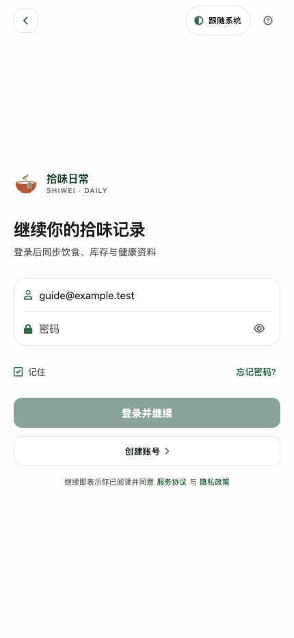

*图 2-2　客户端登录页。截图未填写密码，因此按钮处于不可提交状态。*

### 2.3 新手引导与忘记密码

- 注册后的新手引导提供 **稍后开始** 入口，可先进入应用再补充资料。
- **当前受限**：本次引导页出现“服务器响应不符合 API 契约”。这不等于注册失败；先核对能否正常登录，再使用“稍后开始”，或将现象反馈给维护人员。不要为此重复注册。
- 登录页有 **忘记密码？** 入口，但当前默认 Go 运行时尚未接通生产邮件投递。不能因为看到该入口就认定邮件一定会发送；若无法收信，应联系部署维护人员核对服务能力。
- 生产邮件能力的最新说明以 [认证说明](../authentication.md) 为准。

## 3. 食材入库与库存维护

### 3.1 选择入库方式

**状态：手动录入、文字批量入库已验证；相机、条码、语音未验证。**

从底部 **资产 → 食材** 进入库存页面，点击新增食材的 **＋** 按钮。可见拍照、连续扫描条码、手动录入、文字/口述以及扫描小票等入口。

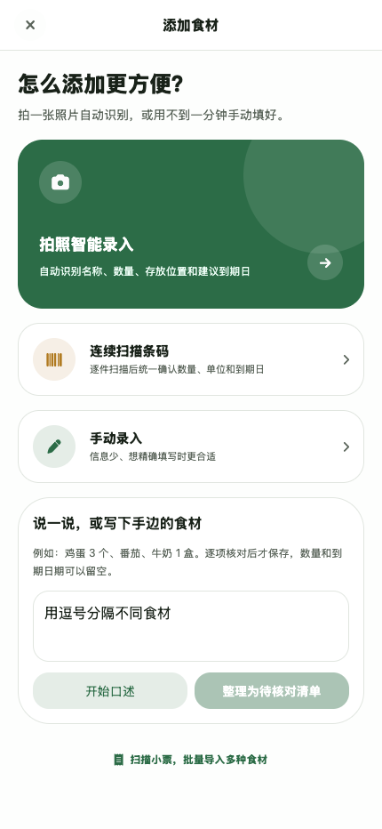

*图 3-1　入库方式选择。存在入口不代表当前设备已具备相机、语音或识别服务能力。*

### 3.2 手动新增一项食材

**前提：已登录，并已核对实物信息。**

1. 在添加食材页选择 **手动录入**。
2. 输入食材名称，例如“番茄”。
3. 打开 **分类** 并核对类别。不要依赖名称自动推荐；本次演示中需手动把“其他”改为“蔬菜”。
4. 填写数量，例如 `500g`；数量不确定时留空。
5. 选择存放位置：**冷藏、冷冻、常温**。按真实保存方式选择。
6. 按包装标注或可靠依据填写到期日期。页面提供 **3 天、7 天、30 天** 等快捷选项，它们不是对食品安全期限的保证。
7. 照片为可选项。完成后点击 **加入食材库**。
8. 返回列表，核对名称、数量、所在分区与日期提醒。

**成功判据**：列表中出现对应食材，而不只是按钮被点击或表单关闭。本次已保存番茄 `500g`，之后又保存了分类修改。

> **食品安全提醒**：保质期估计、剩余天数和临期提示仅辅助管理。包装说明、开封情况、实际温控及变质迹象应优先考虑；不要仅凭应用显示“还有几天”判断食物安全。

### 3.3 修改已保存食材

1. 在食材列表点击对应卡片。
2. 核对名称、分类、数量、位置和日期。
3. 修改需要调整的字段，点击 **保存修改**。
4. 回到列表或重新进入该项，核对修改结果。

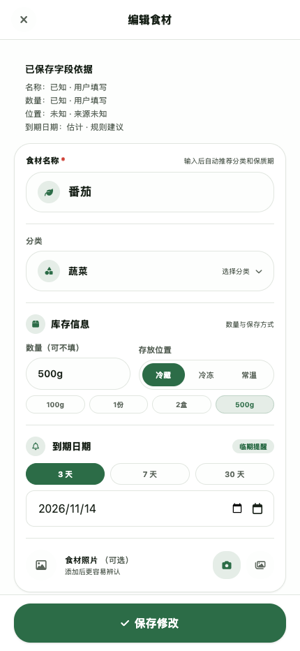

*图 3-2　番茄的编辑表单，分类已调整为“蔬菜”。顶部同时展示字段来源信息；示例日期不代表推荐保质期。*

**移除注意**：编辑页存在 **移除** 入口。执行前确认对象和业务含义，不把“食材已吃掉”“已丢弃”和“误录删除”混为一谈。本次未执行删除，也未验证库存消耗与饮食记录的自动关联。

### 3.4 用文字一次录入多项食材

1. 打开新增食材页，在 **说一说，或写下手边的食材** 区域输入，例如：`鸡蛋 3 个、牛奶 1 盒`。
2. 点击 **整理为待核对清单**。
3. 逐项核对名称、数量、存放位置和日期。移除误识别项，不清楚的字段留空。
4. 点击 **确认并保存 2 项食材**。按钮中的数量应与保留条目一致。
5. 回到库存列表，检查每项是否出现、是否重复。

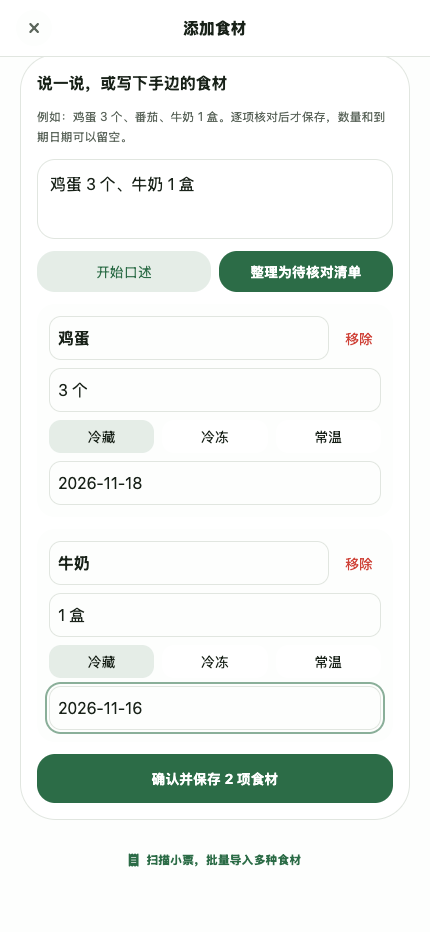

*图 3-3　文字已整理为两项待确认食材。日期由演示人员核对填写，不是从实物包装自动识别。*

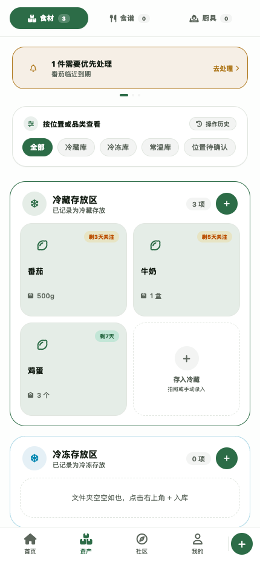

*图 3-4　库存共三项：番茄、牛奶、鸡蛋；可以按分区查看数量与日期提醒。*

### 3.5 保存失败或结果不明确时

- 表单仍在时先保留填写内容，检查提示和网络；不要反复新建相同食材。
- 按钮已经提交但结果不明确时，先返回列表核对，再决定是否重试。
- 页面显示的草稿保留不等于已入库，也不等于跨设备同步成功。
- 临期提醒先用于人工核对；系统通知是否到达还取决于设备权限和后台任务，不能单独作为食品处理依据。

## 4. 采购、食谱与烹饪入口

**整体状态：当前受限；以下为入口和核对要点，不是已验收的完整采购烹饪流程。**

### 4.1 采购清单

进入 **智能采购清单** 页面后，应先检查当前清单，再执行添加或导入。

本次添加操作调用采购导入接口后返回 HTTP 400，没有确认新增成功。因此本版手册不提供“已采购—自动入库”的成功示例。

遇到同类情况：保留待采购内容，核对列表中是否已有该项；若未新增，记录时间、操作方式及错误提示后提交反馈。不要把“清单仍为空”理解成已完成采购，也不要连续重复导入。

### 4.2 阅读食谱

从食谱相关入口打开详情后，至少检查：

1. 食谱名称与份量；
2. 用料名称、数量及过敏原；
3. 完整步骤、火候和熟制要求；
4. 已有食材与缺失食材；
5. 营养数据是否标明来源或估算属性。

**本次实操限制**：演示食谱可以显示标题，但备料区显示“0 种”，用时未标注，步骤未完整展示。不能将此理解为“不需要食材”或“可以直接开始做菜”。

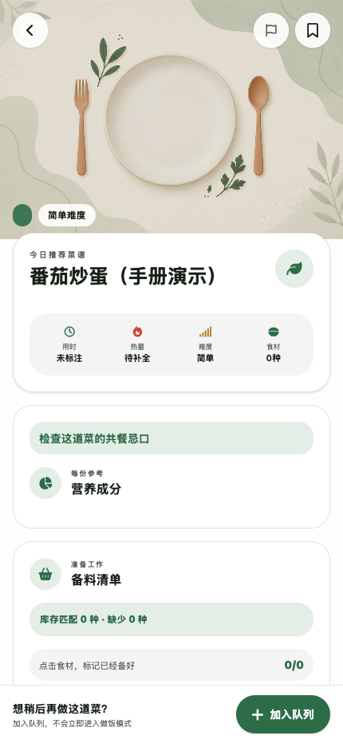

*图 4-1　受限页面，不是正常食谱范例。该食谱仅为隔离数据库中的测试数据，不是通过后台创建食谱流程产生的成果。*

### 4.3 加入队列与烹饪

食谱详情提供 **加入队列**。加入队列与开始烹饪是不同操作，队列中的计划也不代表食材已消耗。

本次点击后未在队列中核对到该食谱，因而未继续确认开做、完成、扣减库存或生成待吃餐。该环节应在接口修复后重新完整验证。

**使用边界**：在食材、步骤或安全信息缺失时，不按此页面执行烹饪。饮食记录可以独立手动录入，见下一章，但手动记录不证明烹饪闭环已经接通。

## 5. 饮食记录

### 5.1 手动记录实际吃过的一餐

**状态：记录名称保存已验证；时间回显与营养汇总部分可用。**

1. 从个人相关入口进入 **饮食记录**。
2. 点击 **记一餐** 或空状态下的 **手动记录**。
3. 核对记录日期，填写实际进食时间，按需选择 **早餐、午餐、晚餐、加餐**。
4. 输入食物名称与份量。
5. 只有具备可靠依据时才填写卡路里、蛋白质、碳水化合物和脂肪；未知时留空。
6. 点击 **保存这餐**。
7. 在 **今天吃了什么** 中核对食物名称及餐别。

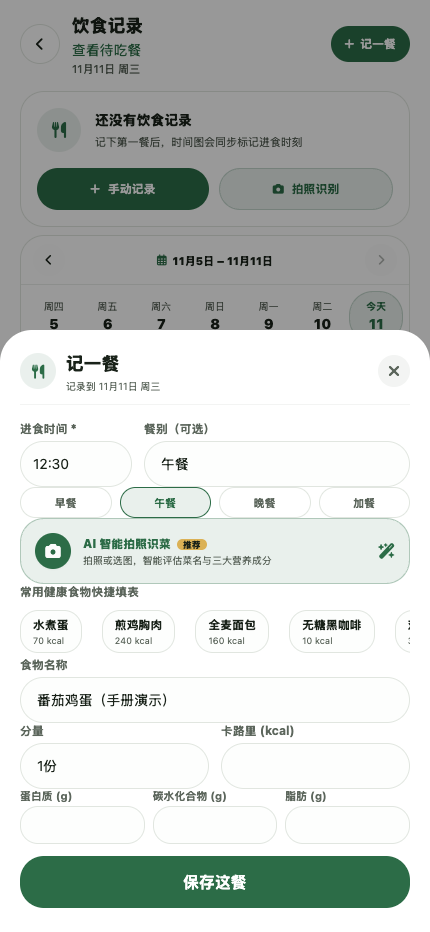

*图 5-1　示例选择午餐、时间 12:30；营养值留空，不编造食物营养数据。*

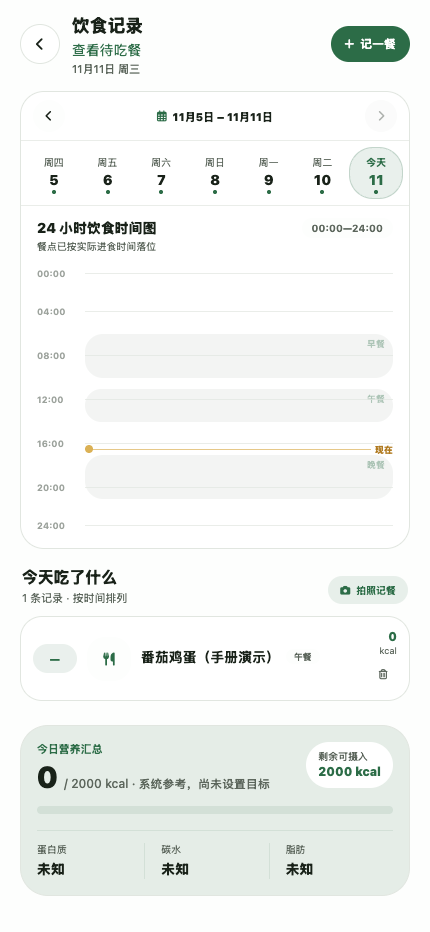

*图 5-2　列表已有一笔记录，但时间显示为“—”，留空热量显示为 0 kcal，其他营养显示“未知”。*

### 5.2 如何解释结果

- 食物名称出现在记录列表，说明本次手动记录已保存到可见列表中。
- **0 kcal 不等于这餐没有热量**：本次是留空后出现的显示结果，不能拿来计算真实摄入。
- 时间未正确回显时，不把时间轴和餐别推断为准确的实际进食时刻。
- 页面“2000 kcal 系统参考”不是个人化医嘱；未设置目标时，不据此自行调整药物或治疗方案。
- 本次个人页和饮食页的当日/周汇总显示存在不一致，不据此认定漏餐、连续打卡或完成目标。

## 6. 个人资料与健康资料

### 6.1 编辑公开个人资料

**状态：简介保存及重新进入核对已验证；头像上传未验证。**

1. 进入 **我的**，点击 **编辑**。
2. 核对公开用户名。当前页面提示为 2–30 个字符。
3. 在 **个人简介** 中填写希望公开展示的内容。
4. 点击右上角 **保存**。
5. 再次进入编辑页，确认内容仍然保留。

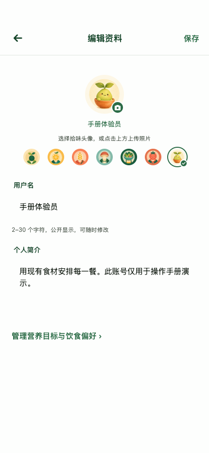

*图 6-1　演示简介已保存，并在重新进入时核对保留。头像选择及上传入口可见，但本次未验证更换头像。*

**隐私提醒**：公开昵称、简介、社区内容与健康资料用途不同。不要把病史、用药、电话或家庭住址写进公开简介。

### 6.2 健康、饮食限制与偏好

编辑资料页下方提供 **管理营养目标与饮食偏好**，可以进入 **我的资料与偏好** 等分组入口。

**当前受限**：本次 **饮食限制与健康资料** 子页显示“资料暂时不可用，请重试”，没有完成健康资料保存。遇到该提示时：

1. 点击 **重新加载资料** 一次；
2. 仍失败则保留原资料，不用空值覆盖已有内容；
3. 记录错误页面及时间，联系维护人员；
4. 在修复前，不假设过敏或饮食禁忌已被推荐、食谱或 AI 正确读取。

## 7. 设置、隐私与账号安全

### 7.1 切换外观

**状态：已验证选择深色并刷新页面后保留。**

1. 进入 **设置与偏好**。
2. 在 **外观** 选择 **跟随系统、浅色、深色**。
3. 返回或刷新页面，检查仍保留选择。跟随系统模式还受设备外观设置影响。

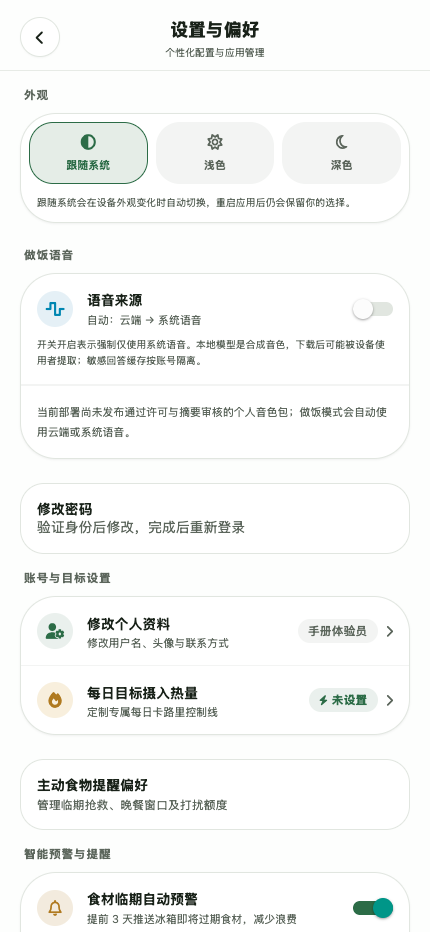

*图 7-1　外观、语音和账号相关设置。提醒开关处于开启，不代表已收到实际系统推送。*

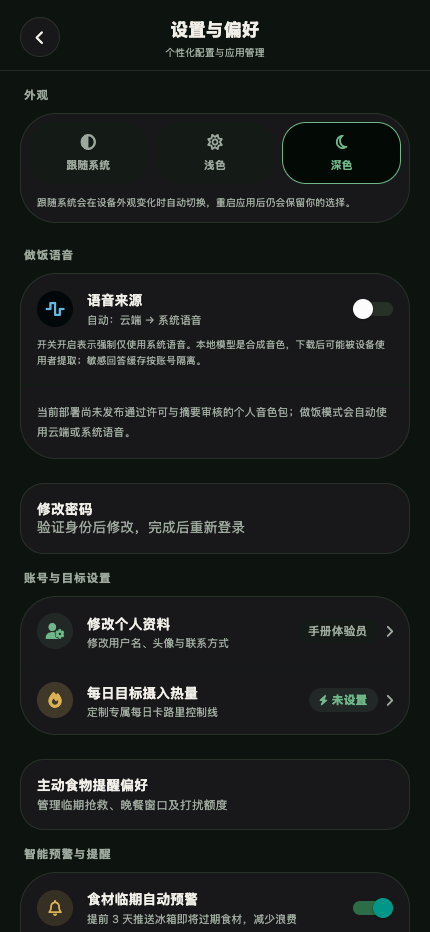

*图 7-2　深色模式刷新后仍保留；本次演示结束前已恢复跟随系统。*

### 7.2 语音与提醒

设置中可见语音来源、临期预警、三餐提醒、饮水提醒及提醒时间设置。

- 页面说明开启“仅系统语音”开关会强制使用系统语音；本次没有进行真实语音播放验证。
- 当前部署未发布通过许可与摘要审核的个人音色包，不应把本地音色下载写成已可用。
- 调整提醒计划后应使用页面的保存入口，并在真实设备核对系统通知权限及实际到达情况。
- 本次没有验证提醒计划保存、云端语音、推送到达、静默时段和前后台切换；这些属于设备与服务联调范围。

### 7.3 隐私、退出与删除

设置下方可见隐私政策、服务协议、AI 数据导出/删除、退出登录和永久删除账号等入口。

- **退出登录**：共享设备使用后应退出，并检查已回到登录页。本次未把退出作为单独验收流程。
- **清理本地缓存**：不等同于删除服务器业务记录。
- **删除 AI 数据或账号**：执行前确认范围、备份和不可恢复影响；不要在真实账号上为了练习而操作。
- 本次未执行导出、永久删除、改密或普通用户找回密码。管理员首次改密见第 10 章。

## 8. 社区动态

### 8.1 发布一条文字动态

**状态：发布并查看详情已验证；图片上传、评论、关注和审核全流程未验证。**

1. 打开底部 **社区**。
2. 点击 **发布社区动态** 图标，进入 **写动态**。
3. 按需输入标题，填写正文。
4. 核对发布板块；示例使用 **寻味**。不要在正文中泄露本人或他人的敏感信息。
5. 点击右上角 **发布**，等待结果。
6. 在动态详情检查标题、正文，并确认出现“发布成功，动态已保存”。


*图 8-1　文字动态发布前核对。图片上限以当前页面提示为准，本次没有上传图片。*

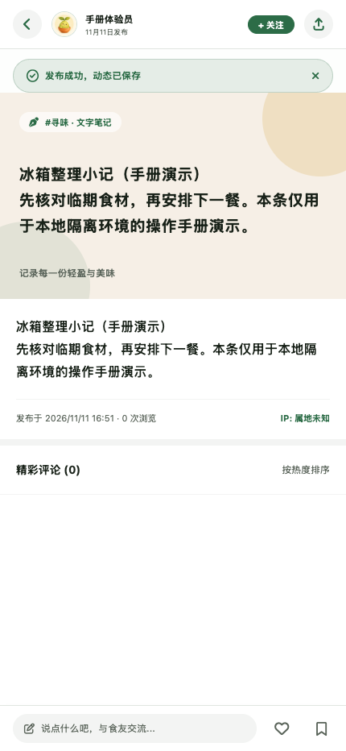

*图 8-2　真实提交后的详情页，出现成功提示。本次发布仅发生在本地隔离环境，不是对外发布。*

### 8.2 浏览异常时

社区首页空状态与详情保存成功是不同的证据。本次发布成功不代表首页推荐、搜索、排行榜、活动和审核已经全部核验。若首页不能加载而详情可见，可先保存详情信息，使用重新加载或提交反馈，不要重复发布同一条内容。

## 9. 帮助与反馈

### 9.1 提交反馈

**状态：已验证提交功能建议并进入“已收到”的反馈详情。**

1. 打开 **帮助与反馈**。
2. 选择类型：**问题反馈、功能建议、联系客服**。
3. 填写描述，建议包含“发生页面、操作步骤、预期结果、实际结果、发生时间”。当前页面上限为 2000 字符。
4. 不填写密码、验证码、完整健康记录或无关个人信息。
5. 点击 **提交反馈**，等待进入反馈详情。

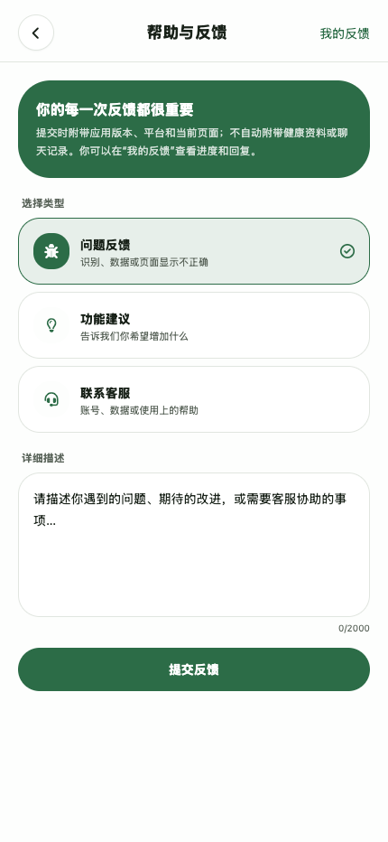

*图 9-1　提交时页面说明会附带版本、平台和当前页面，不自动附带健康资料或聊天记录。仍应在发送前自行检查正文。*

### 9.2 查看进度与补充说明

成功提交后记录反馈编号。可从 **我的反馈** 入口继续查找进度；详情页提供 **刷新、发送补充、新建反馈**。

本次已确认自动跳转反馈详情及“已收到”状态，未额外验证历史列表检索、补充发送及后台回复闭环。


*图 9-2　反馈 #1 已收到。此状态表示反馈已登记，不表示运营人员已阅读、已回复或已解决。详情中的时间显示与其他页面可能采用不同格式或时区，核查时请同时提供编号。*

## 10. 后台管理员操作

### 10.1 登录与首次改密

**状态：管理员登录、首次改密、重新登录已验证。**

**前提**：运维人员已按部署流程创建管理账号，并通过安全方式交付初始凭据。系统没有可在本手册公开的通用管理员密码。

1. 打开管理控制台登录页。
2. 输入管理员账号、密码，点击 **登录管理控制台**。
3. 如果进入 **首次登录安全设置**，输入当前密码、新密码与确认新密码。
4. 点击 **修改密码并重新登录**。
5. 使用新密码重新登录，进入工作台。

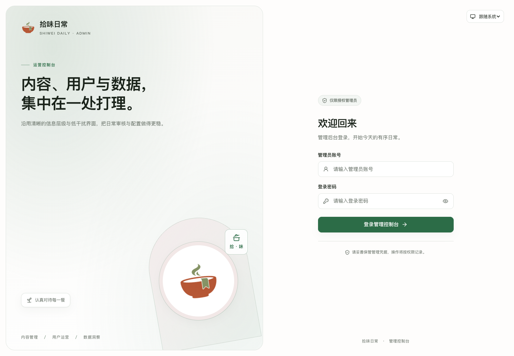

*图 10-1　后台只供授权管理员访问。*

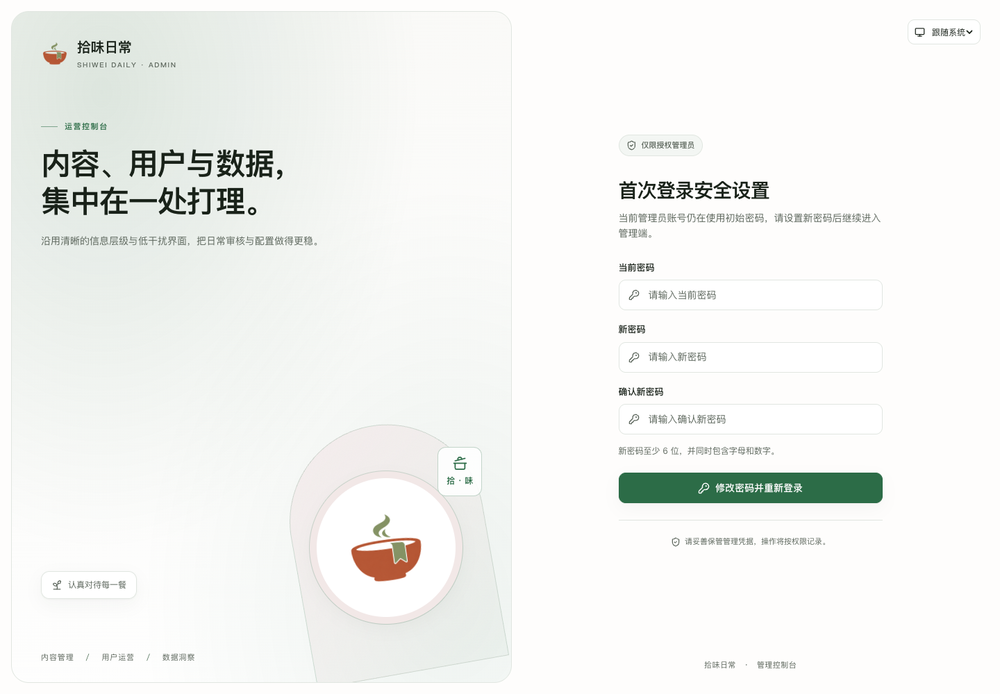

*图 10-2　完整改密表单。本次实际完成过首次改密；配图为再次打开表单后的空字段展示，未再次修改密码。*

**安全要求**：不在群聊、反馈、文档或截图里分享凭据。不借用普通用户账号开展管理员操作。账号创建、初始化与密码交付由运维负责，见 [部署与恢复手册](../operations.md)。

### 10.2 查看工作台

**状态：部分可用。**

1. 登录后进入 **工作台**。
2. 检查运行异常、等待用户继续、待处理事项及最近管理操作。
3. 关注各区块自己的更新时间和错误提示；点击对应区块 **刷新**，不要只看整页是否打开。
4. 通过 **查看全部** 进入相应业务列表，核对后再处理。

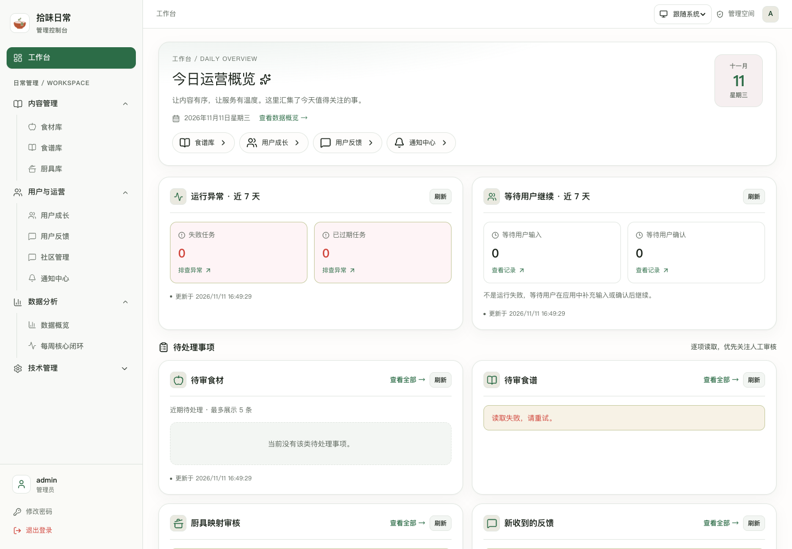

*图 10-3　工作台可以显示，但部分区块明确提示“读取失败，请重试”。读取失败不等于没有待办，孤立的 0 也不证明整个服务正常。*

### 10.3 用户列表、搜索与详情

**状态：已验证；已包含本次防崩溃修复。**

1. 从左侧 **用户与运营 → 用户成长** 进入 **用户管理**。
2. 检查当前已加载用户及筛选标签。
3. 输入用户名、邮箱、手机号或 ID 搜索。搜索框针对的是 **已加载记录**，不保证搜索整个用户库；需要时先加载更多。
4. 点击用户名查看详情，核对 ID、注册时间和联系方式。
5. 查看完成后关闭详情；需要更新数据时点击 **刷新**。

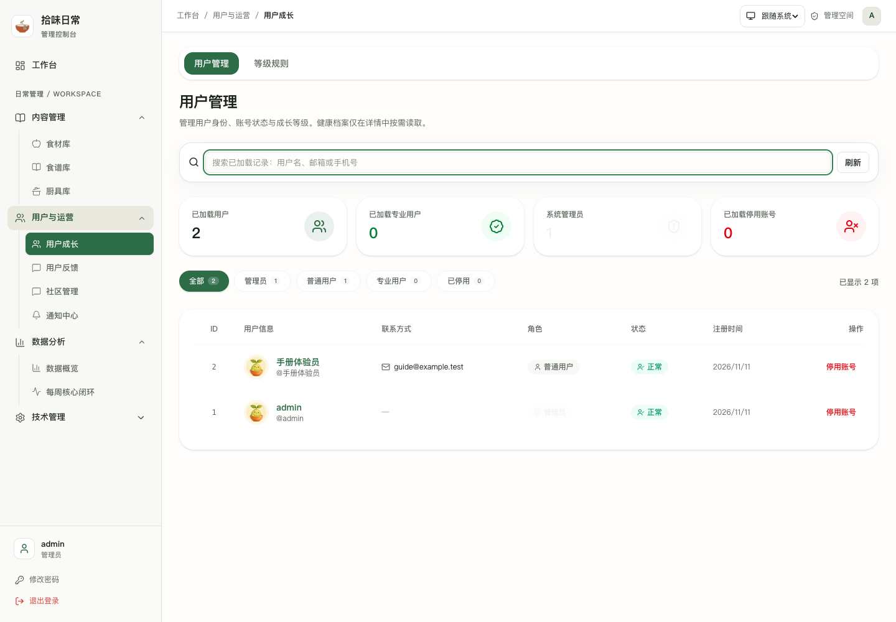

*图 10-4　真实列表正常加载，可搜索并打开详情；统计只针对已加载记录。*

**高风险操作**：停用、恢复、角色变更、凭据重置和经验调整可能影响用户权益。执行前应核对用户 ID、授权及原因，遵守组织的审批与审计制度。本次只验证读取、搜索与详情，未执行这些变更，也未验证后台读取健康资料。

### 10.4 通知中心

**状态：页面可用、业务能力受限；已包含本次防崩溃修复。**

1. 进入 **用户与运营 → 通知中心**。
2. 检查顶部是否出现“当前接口仅提供部分通知数据”的提示。
3. 对标为 **不可用** 的设备数、投递指标或自动提醒记录，不作零值统计或运营结论。
4. 点击右上角刷新按钮可以重试读取。
5. 当前演示 Go 接口不满足完整通知概览要求，页面已禁用 **发送**。请由维护人员核对接口与投递能力，不通过其他入口绕过保护。

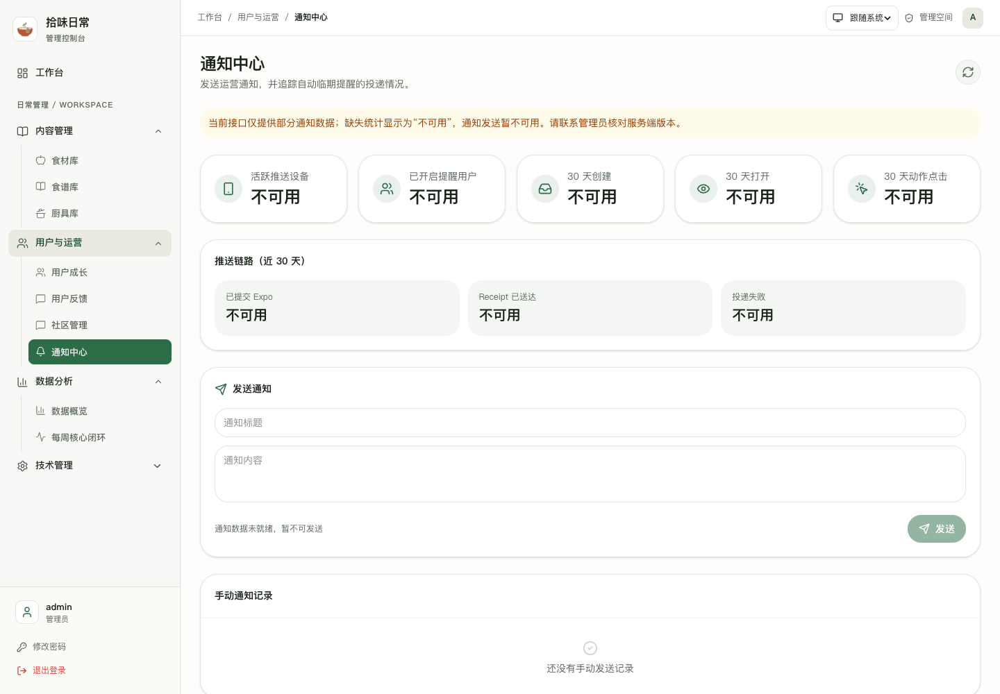

*图 10-5　页面不再崩溃；缺失指标明确显示“不可用”，发送按钮禁用。*

**投递判据**：创建草稿、创建站内信、提交推送、设备收到、用户打开是不同状态。当前 Go 创建活动接口只保存草稿，不能当作已向所有用户发送。此手册没有任何成功群发或真实推送的证明。

### 10.5 保存 AI 配置草稿

**状态：修改系统提示词、保存草稿、刷新后核对内容已验证；发布与外部调用未验证。**

1. 展开 **技术管理 → AI 服务 → AI 服务配置**。
2. 进入 **旧配置与策略**。这是兼容入口；页面同时提供“服务提供商”“业务服务”等入口，但本次没有完成其配置验证。
3. 在修改前记录既有配置，并确认自己有配置权限。不要点击“显示”暴露真实密钥。
4. 找到系统提示词区域，修改职责、语气及安全边界。示例强调核对库存与过敏信息、说明未知信息、不提供医疗诊断。
5. 点击 **保存 AI 配置草稿**，等待完成。
6. 重新加载页面，核对修改后的提示词仍然存在。

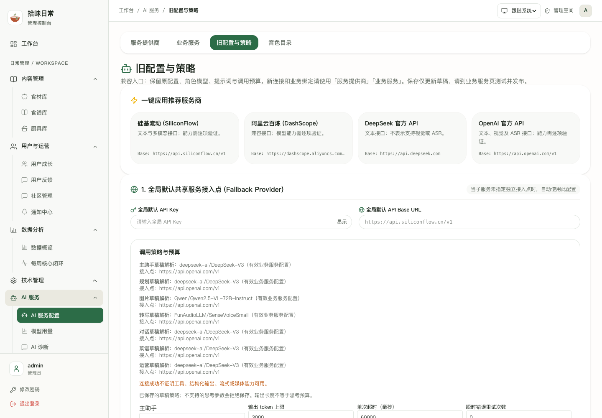

*图 10-6　接入点与调用策略页面。截图密钥为空；预设服务商和模型名称不代表已经接通或适用于所有任务。*

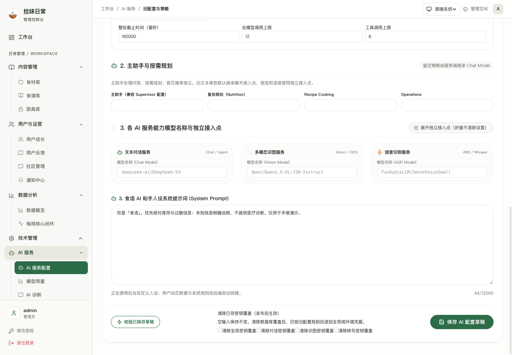

*图 10-7　保存草稿后重新加载，提示词仍保留。没有填写真实密钥或执行外部连接测试。*

**必须区分**：保存草稿不等于发布，不证明当前客户端已经使用新配置。页面提示应到业务服务页测试并发布；本次没有执行该流程。连接成功也不自动证明图片、语音、工具调用、流式响应及结构化输出都可用。

不要随意勾选“清除已存密钥覆盖”等选项，也不要把密钥放进提示词。生产发布前应另外确认权限、预算、数据发送范围及回滚方案。

### 10.6 内容、反馈与其他后台入口

左侧可见食材库、食谱库、厨具库、用户反馈和社区管理。**本次后台食材、食谱、反馈列表曾出现接口返回结构引发的页面异常，未完成这些页面的审核、编辑或回复闭环。**

用户管理和通知中心的修复不代表其他列表已同步修复。遇到白屏、错误堆栈或读取失败时停止提交，记录路径与时间，交由维护人员处理；不要把报错截图当作正常业务界面教学。

## 11. 常见问题与处理

| 现象 | 首先如何处理 | 何时联系维护人员 |
| --- | --- | --- |
| 登录失败 | 检查账号、密码及网络；确认访问的是正确环境 | 合法账号仍无法登录，或出现权限异常 |
| 新手引导提示 API 契约错误 | 不重复注册；尝试重新加载或稍后开始 | 重试后持续出现 |
| 入库后不确定是否成功 | 先查列表中的名称、数量及日期，再考虑重试 | 列表缺失或重复，且无法自行确认 |
| 分类不符合实物 | 打开编辑，人工选择类别并保存 | 重新进入后仍未保留 |
| 饮食记录显示 0 kcal、时间为“—” | 不把缺失数据当真实零值，保留记录名称与实际时间 | 需要准确统计或时间回显时 |
| 健康资料提示不可用 | 重新加载，不以空值覆盖旧资料 | 仍无法读取，或禁忌信息没有被正确使用 |
| 后台统计显示“不可用” | 查看局部提示、刷新对应页面 | 服务版本或统计能力不匹配 |
| 没有收到邮件或推送 | 区分服务未接通、未提交、权限未开和实际投递失败 | 默认 Go 生产邮件未接通，或真实设备联调失败 |
| 反馈已收到但没有回复 | 记录反馈编号，查看进度；避免重复提交 | 超过组织约定响应时间；本手册不承诺具体时限 |
| 页面白屏或显示错误堆栈 | 不继续提交，保存错误路径、时间、复现步骤与脱敏截图 | 立即交由维护人员排查 |

**推荐的问题描述模板**：

```text
发生时间与时区：
应用版本与设备/浏览器：
页面或功能入口：
复现步骤：
预期结果：
实际结果与错误提示：
相关记录编号（如反馈编号）：
脱敏截图：
```

不要把访问令牌、请求 Authorization 头、数据库文件或账号密码附在问题描述中。

## 12. 当前限制与未验证范围

### 12.1 当前已知限制

| 编号 | 环节 | 本次观察及影响 | 推荐处理 |
| --- | --- | --- | --- |
| L-01 | 新手引导 | 出现 API 契约错误，不能按引导完成初始化 | 重试或稍后开始；修复后复验 |
| L-02 | 采购导入 | 返回 HTTP 400，未确认新增成功 | 不重复导入；反馈接口问题 |
| L-03 | 食谱详情与队列 | 食材/步骤等未完整展示；加入队列后未核对到记录 | 不按缺失信息烹饪；闭环修复后复验 |
| L-04 | 饮食记录 | 名称保存成功；时间与未知热量展示存在偏差，汇总不一致 | 不依赖该结果作准确营养或时间分析 |
| L-05 | 健康资料 | 子页读取失败，未验证保存 | 不假设禁忌已被推荐系统采用 |
| L-06 | 后台工作台与部分列表 | 局部读取失败；内容/反馈列表曾崩溃 | 按模块排查；不把读取失败当空数据 |
| L-07 | 通知中心 | 页面崩溃已修复；Go 概览字段仍不完整，发送禁用；活动创建只存草稿 | 服务端补齐并联调实际投递后再开放 |
| L-08 | 生产邮件 | Go 运行时生产邮件投递尚未接通 | 由维护人员提供明确可用的账号恢复路径 |

用户管理页的列表崩溃已修复并实测，不再作为未解决问题列入上表。通知中心只完成防崩溃与安全展示，未完成通知业务实现。

### 12.2 没有验证的范围

- Android/iOS 安装、真机交互、系统权限、后台运行和系统推送。
- 相机、条码、小票识别、麦克风、云端语音、离线音色及外部 AI 实际调用。
- 邮件投递、找回密码、AI 配置发布与回滚。
- 家庭协作、成员权限、周计划、厨具维护、订阅/付费等未逐项实操功能。
- 库存消耗、采购转入库、完整烹饪流程、待吃餐与实际饮食记录自动关联。
- 管理端审核、账号权限变更、停用/重置、群发通知、真实数据导出及永久删除。
- 并发、性能、生产数据迁移与完整安全审计。

**上述边界不代表功能永久不可用，而是本手册没有相应实操证据。** 对生产环境的可用性承诺，应基于该部署的验收记录，而不是本地截图。

## 13. 维护与修订

### 13.1 修订记录

| 版本 | 日期 | 变更说明 |
| --- | --- | --- |
| V1.0 | 2026-11-11 | 首次编制；完成客户端与后台实操截图；纳入用户管理、通知中心防崩溃修复后的截图及已知限制 |

### 13.2 更新要求

当页面入口、字段、权限或接口能力变更时，同步更新步骤、状态、截图和 [核验记录](verification.md)。截图重拍须使用虚构数据，遮蔽凭据，并实际打开检查；不以模拟响应或设计稿替代真实操作成果。

本手册采用文档控制、任务步骤、结果核对、异常处理和修订记录的组织方式，未声明通过某一国家标准或行业标准的形式认证。
